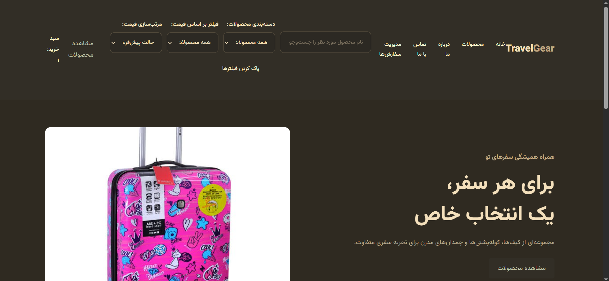
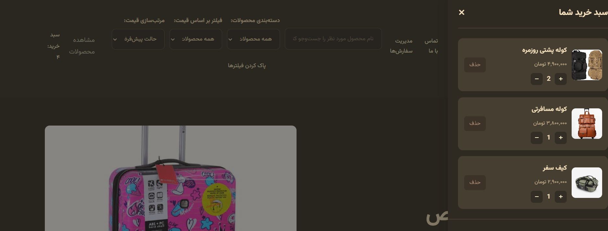
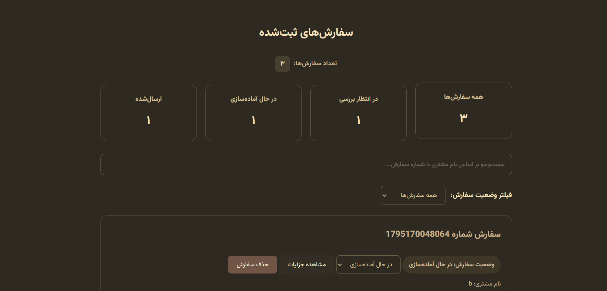
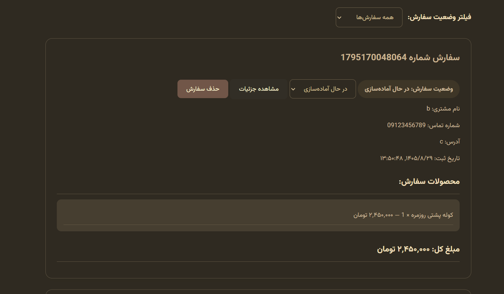
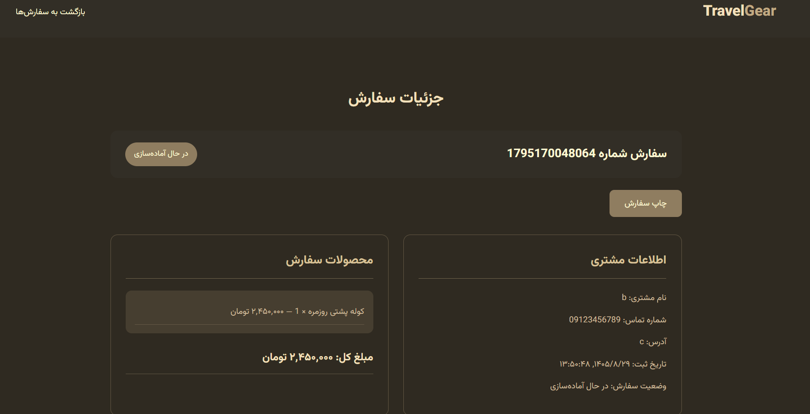

# TravelGear 🧳

A responsive e-commerce website for bags, backpacks, and travel accessories.

## Features

- Product search
- Category filtering
- Price filtering and sorting
- Shopping cart
- Quantity management
- Checkout form with validation
- Order management
- LocalStorage data persistence
- Responsive design

## Technologies

- HTML5
- CSS3
- JavaScript
- LocalStorage

## Live Demo

https://pouya194.github.io/TravelGear/

## GitHub Repository

https://github.com/pouya194/TravelGear

## Screenshots

### Homepage

### Shopping Cart

### Checkout Form

### Orders Dashboard

### Order Details

